# Enclosure

The owner's renders (brief Appendix C, images 2 and 3) are a **rough sketch of intent, not a
source of truth**: they show two buttons, while the real rig has one Mini Button (the 5-port
blocks happen to match the Wago 221s now on the rail). Use them for the general feel and envelope only.

What the renders show (described, the images were not provided as files; add them to
`docs/assets/` if you want them versioned):
- **Rear view:** grey mock-up in a thin bounding-box frame; the Core's back shell in the middle; a
  small M5 unit top-left; a row of Wago-style blocks along the bottom; the power bank standing on
  the right edge with a two-button part and a bracket on top; a USB-C breakout (pads G, D+, D−, V)
  next to the bank with a USB-C plug.
- **Front view:** bank on the left edge with the two-button part on top; the Core above; four
  CamS3 units in a row with conical lens collars and base clips; a unit top-right; one lens hole
  shows a small green PCB.

## v1: foam-board body

A 3 mm foam-board body sized from the owner's render (owner, 2026-11-15): **157.5 × 83.5 × 32 mm**,
plus the Mini Button on top. The box is exactly as tall as the bank, so the bank in its sleeve is
the grip. Four lenses in a row start right next to the grip, ~18 mm of plain front sits to the right
of them, and a small rounded flash window is in the top-right corner.

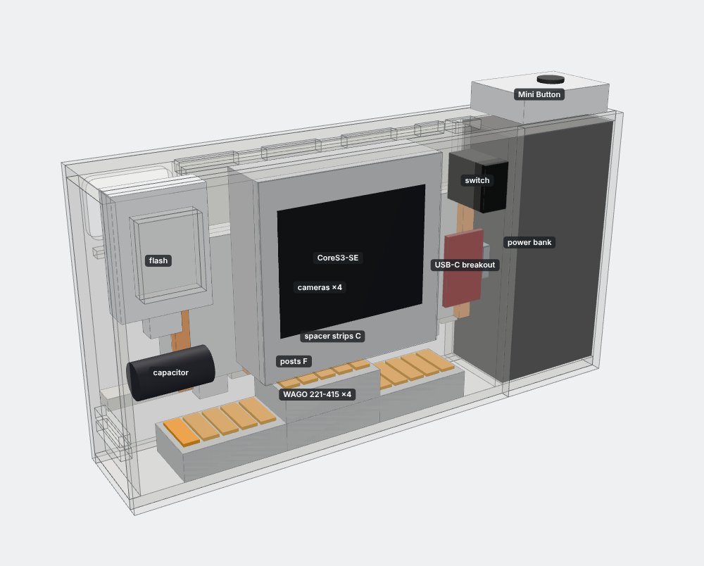

Files (all made by `tools/enclosure/`, see [Regenerating](#regenerating)):
- [x4cam-body.pdf](assets/enclosure/x4cam-body.pdf): 10 step pages with pictures, then the 3 template sheets at 1:1.
- [x4cam-body.html](assets/enclosure/x4cam-body.html): the same steps as a 3D model you can rotate.
  Download it and open it in a browser; it works offline. "Black board" and "X-ray" toggles.
- Templates: [sheet-1.svg](assets/enclosure/sheet-1.svg) (front, door, sleeve back),
  [sheet-2.svg](assets/enclosure/sheet-2.svg) (top bar, posts, spacer strips, flash pad),
  [sheet-3.svg](assets/enclosure/sheet-3.svg) (top, bottom, walls).

### What goes where

- **Grip:** the bank slides into a sleeve from the left end (front view). The sleeve carries its
  weight, so the plug and the breakout's solder joints carry none.
- **Front layer:** the four cameras touching (lens pitch 24.1 mm), Grove ends down. A laminated top
  bar, posts and the walls hold them.
- **Cooling gap:** 3 mm spacer strips on the camera backs. Everything rests on something:
  front ← cameras ← strips ← Core and flash ← door.
- **Back layer:**
  - the breakout and the switch next to the bank wall;
  - the Core in the door window, screen flush with the outside;
  - the flash half behind camera 4, with its LED just past camera 4's edge and above its top;
  - the capacitor under the flash.
- **Bottom:** 3 WAGOs in a row and 1 on top of the middle one, pushed against the door, holes
  facing forward. The Grove cables drop straight into them.
- **Later:** room on the top, right of the bank, for extra buttons or a scroll wheel
  (G5/G6/G8/G9 on the M-Bus header).

### Dimensions and sources

| part | size (mm) | source |
|---|---|---|
| Unit CamS3-5MP | 40 × 24 × 11 (9 body + 2 lens boss) | **VERIFIED**: M5 product page; M5's STL (`m5stack/M5_Hardware`, `U174‑B_Unit_CamS3‑5MP/Structures`) |
| lens centre | 26.5 from the Grove end | measured from M5's STL, ±0.5 |
| Unit FlashLight | 32 × 24 × 8 | **VERIFIED**: M5 product page |
| flash LED | 23.5 from the Grove end | measured from M5's STL, ±0.5 |
| CoreS3-SE | 54 × 54 × 15.5 | **VERIFIED**: M5 product page says 15.5 deep, M5's STL is 16.5 (M5's sources disagree; the template allows 16.5) |
| Unit (Mini) Button | 32 × 24 × 8 | **VERIFIED**: M5 product page (Unit Button U027) |
| WAGO 221-415 | 30 × 8.4 × 18.6 | **VERIFIED**: WAGO data sheets (versions differ by a few tenths) |
| Anker A1653 bank | ~77 × 37 × 25 | listings differ (76–77 × 35.5–37 × 25–25.4). **Measure yours** |
| bank plug position | socket centre 40 below the top inner face, 15 behind the front inner face | **Not sure**: check where your plug comes out |
| capacitor 2200 µF | Ø10 × 20 assumed | **Not sure**: room for about Ø13 × 22 under the flash |
| Grove plug | sticks out ~6.5 | **Not sure**: measure one |
| foam board | 3.0 | "3 mm" board is often 3.0–3.3. **Measure yours** |

### 1. Measure, print, cut

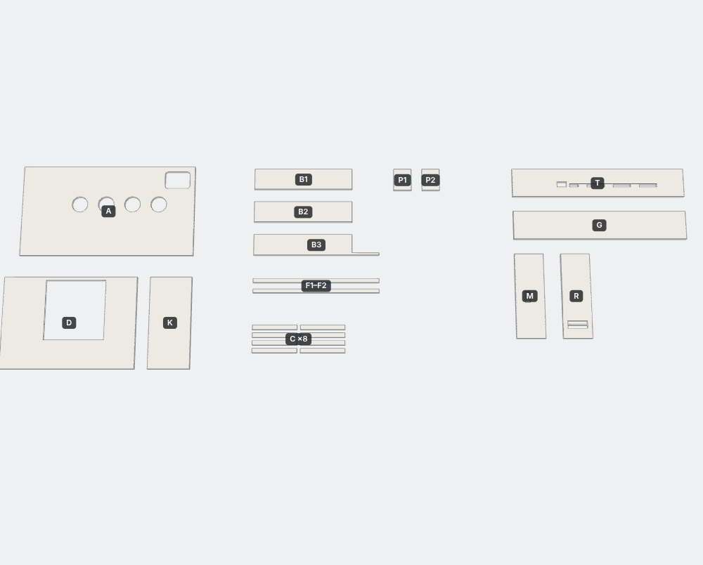

- Measure the board, the bank, the capacitor and a Grove plug. If anything differs from the table,
  change the numbers at the top of `tools/enclosure/gen.py` and regenerate.
- Print the 3 sheets at **100 % / actual size** (no "fit to page") and measure the 50 mm bar on
  each.
- **Cut list:**
  - A front, D door, K sleeve back;
  - B1–B3 top bar, F1–F2 post strips;
  - C × 8 spacer strips, P1–P2 flash pad;
  - T top, G bottom, M middle wall, R right wall.
- Use a fresh blade and a steel ruler. Cut in **three passes** (top paper, foam, bottom paper) with
  the blade vertical.
- Cut the lens holes and the flash window 0.5 mm small, then sand them to size.
- Cut the solid lines only. The dashed ones (switch, Core SD slot, button cable, flash pad) are
  marked from the real parts later.

### 2. Laminate the top bar and the posts

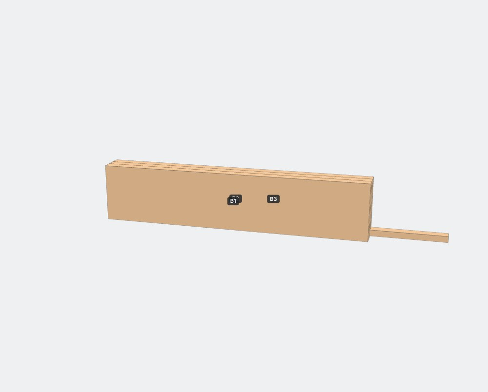

- **Top bar:** B1 + B2 + B3 with thin PVA, left ends and top edges flush. **B3 goes at the back**:
  its 2 mm lip stops camera 4 sliding up into the flash opening.
- **Posts:** laminate F1 + F2 the same way. When dry, cut the 5 dashed notches through both layers
  at once.
- Press both flat under books for 2 h or more.

### 3. Top bar and posts onto the front

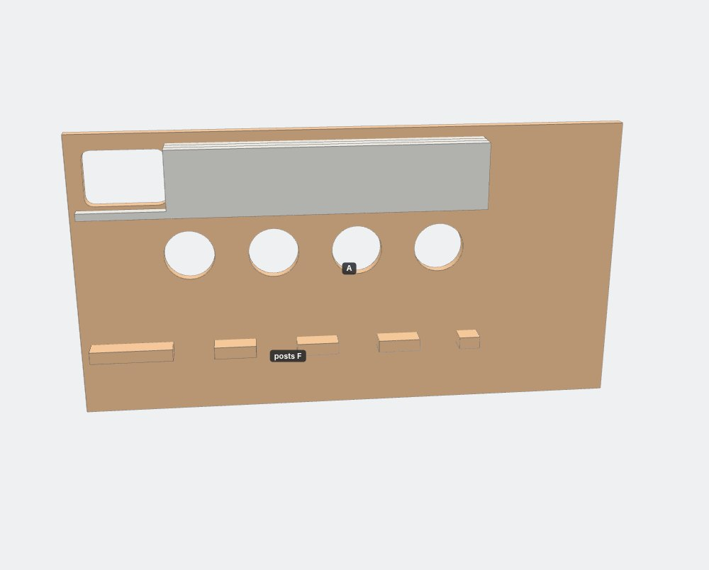

- Glue the top bar on A's inside face. Its **top edge goes 3 mm below A's top edge**, its **left
  end 40.5 mm from A's left end**.
- Put the four cameras in, lenses in their holes, tops against the bar.
- Slide the posts under the cameras, one between each pair of Grove plugs and one at each end, and
  glue the posts to A.
- Take the cameras out before the glue sets. Keep glue 5 mm away from every hole.

### 4. Build the shell

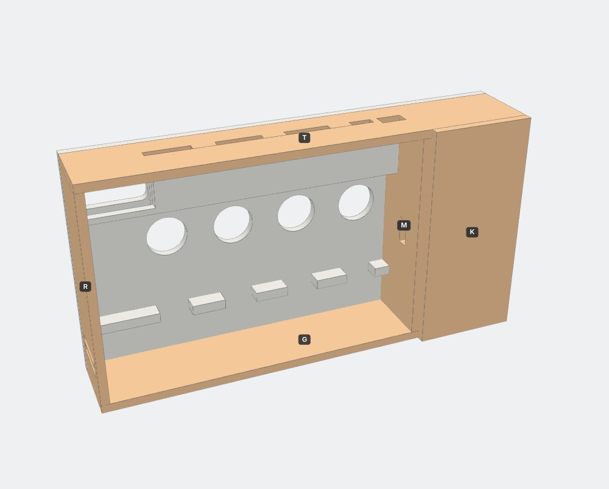

1. **M** (middle wall) on A's inside, 37.5 mm from A's left end. "front →" on M faces A.
2. **R** (right wall) at A's right end.
3. **T** and **G** on top and bottom, the full 157.5 mm, over the ends of M and R. T's slots go
   over the gap behind the cameras.
4. **K** closes the back of the sleeve. The left end stays open: that's where the bank goes in.

- Use a low-temperature glue gun (a hot one melts the foam) and hold each joint square for about
  20 s. Then run a glue fillet along every inside corner.
- Check it's square: the two diagonals of the back opening should match within 1 mm.

### 5. Cameras and the cooling gap

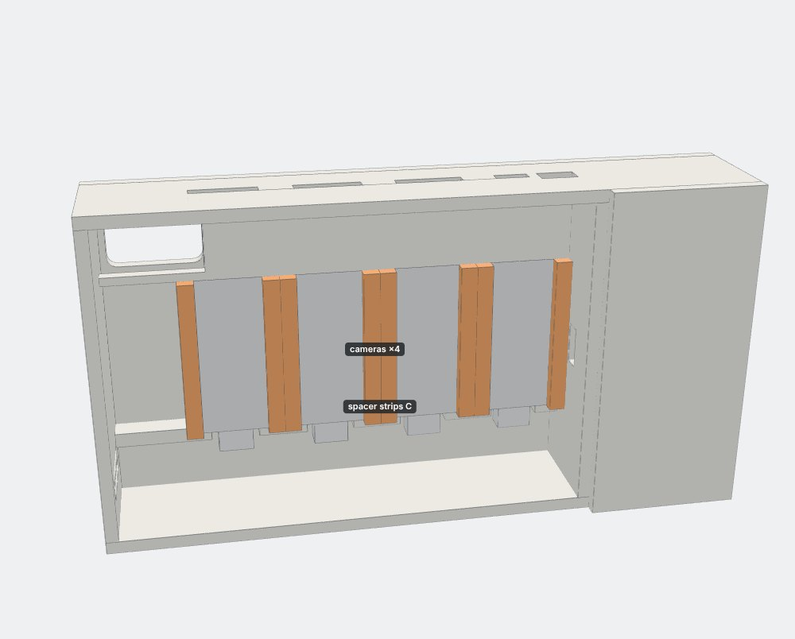

- Plug the Grove cables in first. Then put the cameras in, **Grove end down**, numbered 1–4 from
  the bank side.
- A strip of paper tape across each camera's back holds it in.
- **Spacer strips C:** double-sided tape, two per camera along the long edges. The 3 mm channel
  between them is the air path: in through R's slots, up behind the cameras, out through T's slots.
- **Not sure** what Grove-down does to the picture orientation. Take one shot and check before
  closing anything.

### 6. Flash, capacitor, breakout, WAGOs

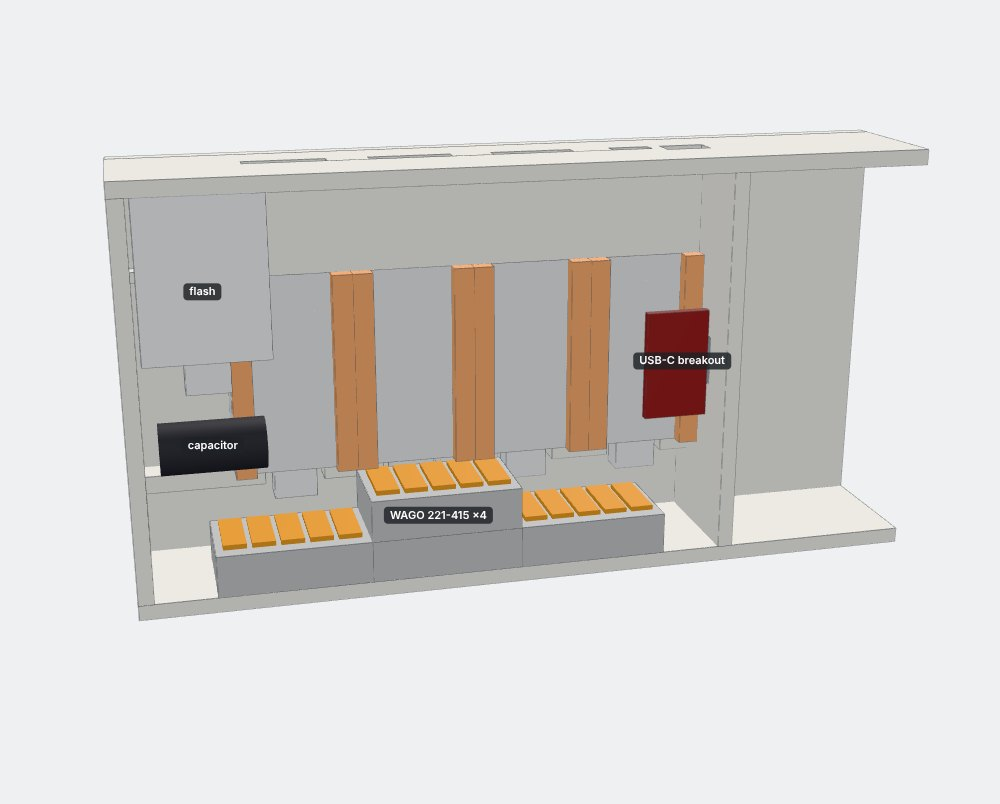

- **Flash:**
  - Grove end down, face forward, top 0.5 mm under T. Its left half rests on camera 4's spacer
    strip.
  - Look through the window in A: the whole LED must show, just right of camera 4's edge.
- **Capacitor:** lying under the flash, below its Grove plug, taped to R. Mind the polarity stripe.
- **Breakout:**
  - On M, with the socket through M's hole and its mouth flush with M's sleeve-side face.
  - Anker says the plug reaches through 4.9 mm phone cases, so a 3 mm wall is fine.
  - Hot glue the board's edges, not the socket.
- **WAGOs:**
  - 3 in a row on the bottom and 1 on top of the middle one, holes facing forward, against the
    door line, with hook-and-loop underneath.
  - The Grove cables come straight down in the ~7 mm in front of them. Power wires from the back
    layer go round the ends of the row.
  - The outer two have ~15 mm above them for the levers. The middle pair slides out backwards when
    the door is open.
- Wire everything as in [WIRING](WIRING.md). The Mini Button cable comes in through the hole in T,
  just behind camera 1.

### 7. The door: Core, switch, flash pad

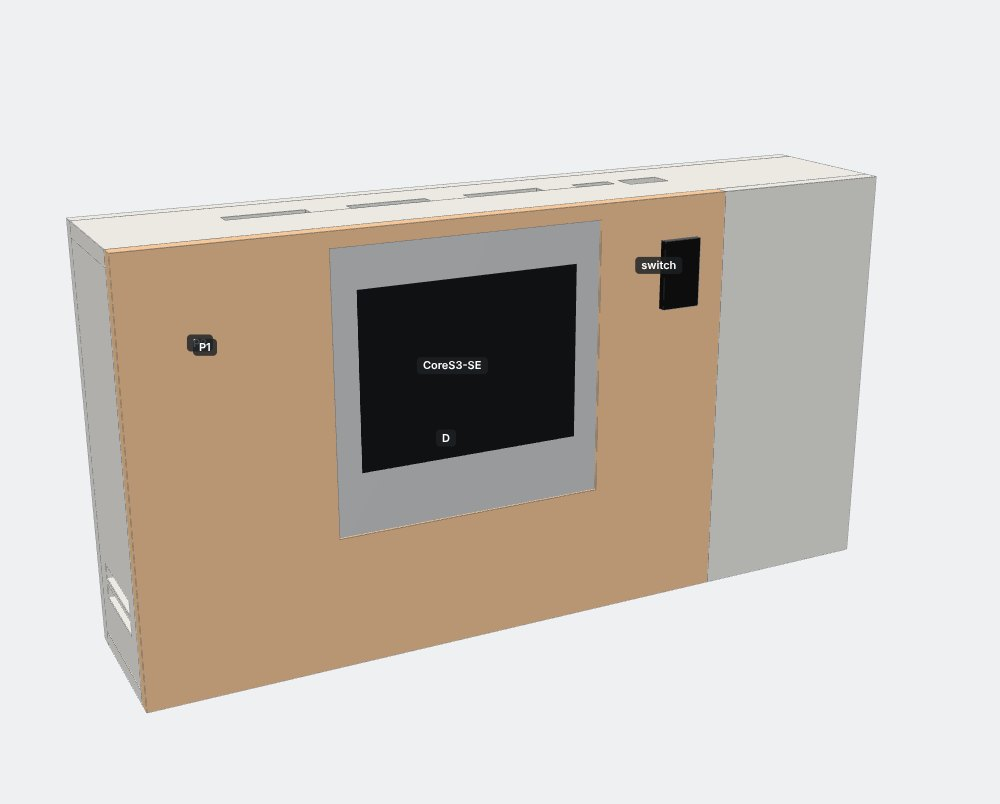

- **Core:**
  - Press it into D's window from inside, screen out, flush with the outside face.
  - Two strips of tape across its inner face onto the door hold it when the door is open.
- **Flash pad:** glue P1 + P2 inside the door on the dashed mark. When the door is closed, it
  presses the flash forward.
- **Switch:** snap-in rockers are usually made for 1–2 mm panels (**Not sure** about yours). In
  3 mm foam the clips won't catch, so hot glue it from inside or use a thin plastic plate.
- **Hinge:**
  - Cloth or gaffer tape along the top edge, inside and outside.
  - Close it with a hook-and-loop tab at the bottom.
  - Leave about 30 mm of slack in the Core and switch wires.

### 8. Bank and Mini Button

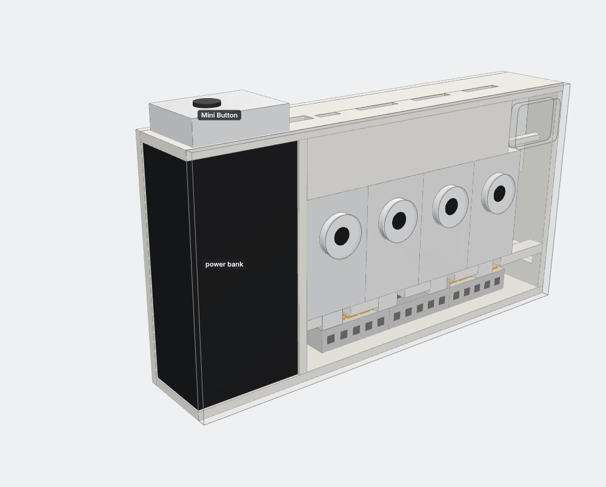

- **Bank:**
  - Put hook-and-loop pads on the sleeve floor and on the bank.
  - Slide it in from the open end and push it into the socket. To charge it, pull it out by its
    exposed end.
- **Mini Button:** on the sleeve top with hook-and-loop. Don't glue it to the bank.
- The bank's own indicator is the battery gauge ([ADR-014](DECISIONS.md)). **Not sure** where its
  LEDs are: if the sleeve covers them, cut a small window over them.

### 9. Finish and test

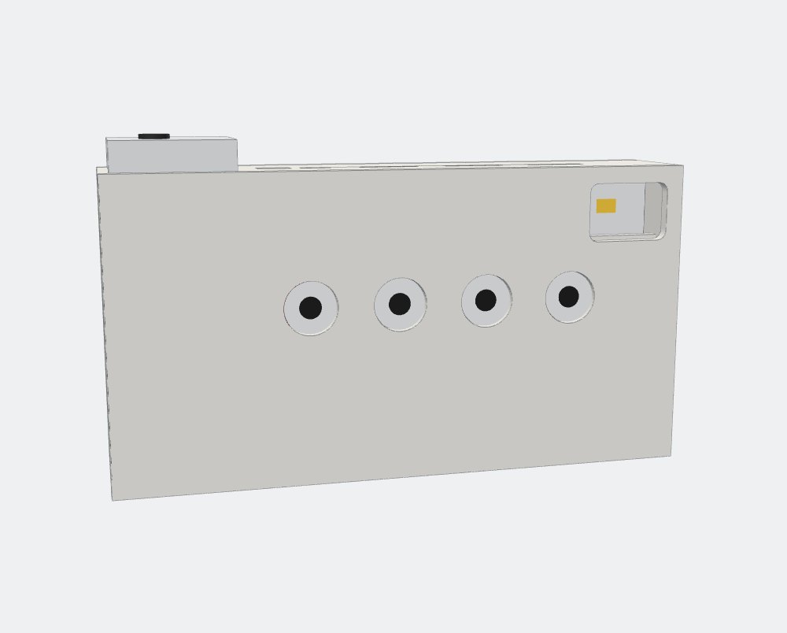

**Finish**
- **Black out the flash opening** with matte black paint inside it: the top bar end, the lip, R,
  the underside of T and the window edge.
  - Do the lens-hole edges too.
  - White foam glows, and the flash sits right next to camera 4's lens.
- Paper tape over the outside corners, then sand the edges lightly (400 grit).
- Skin it (see [Edges and corners](#edges-and-corners)) or paint it: gesso first, then water-based
  acrylic. **No spray paint, no solvent glue, no superglue** near foam or lenses. Superglue fumes
  fog lenses.

**Test**
1. **Flash coverage:**
   - The window lets the beam out to ~27° up, ~29° down and ~37° to each side.
   - The cameras see roughly ±37° × ±29° (worked out from the 88° DFoV).
   - The top edge of the picture may come out slightly darker (**Not sure**). Shoot a white wall at
     1–2 m with the flash and look at the corners.
2. **Light leak:** in a dark room, fire the flash at a dark wall. A haze or ring in camera 4 means a
   leak.
3. **Heat:** run the soak ([BRINGUP step 8](BRINGUP.md#step-8--soak)) with the door closed.
   - M5 rates the CamS3-5MP unit and the CoreS3-SE for **0–40 °C** (**VERIFIED**, M5 product
     pages).
   - The ESP32-S3 module inside is a 65 °C-ambient part (**VERIFIED**, Espressif). The unit
     rating is the stricter one, so go by it.
   - Touch T over the slots: warm is fine, hot is not.
4. **Power:** the wiggle and drop tests from [SOLDERING](SOLDERING.md), with the bank in the sleeve.

### In black foam board

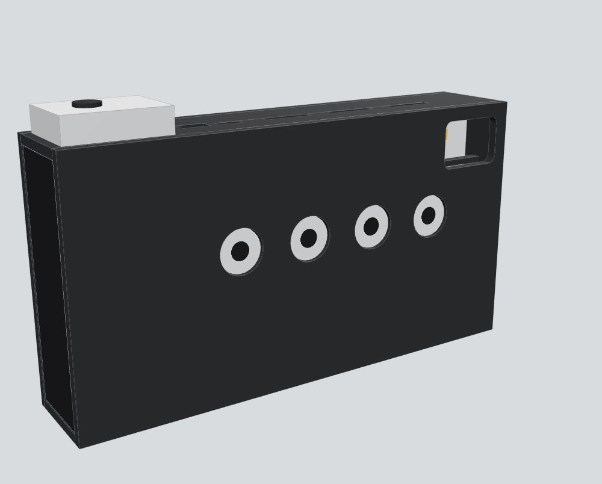

Black 3 mm foam board (black core, black paper) comes in the same sizes. It gives no glowing edges
and no light through the walls, and needs no paint. Mark it with a silver pen, or tape the paper
template on and cut through it.

### Edges and corners

The templates assume plain butt joints. Ways to get cleaner or rounder edges:

- **V-groove fold (crisp corner, no seam):** cut a 90° V (two 45° cuts) through the foam but not
  the outside paper, then fold. One piece can then make two faces, e.g. front and top. A 45° bevel
  or mat cutter makes it repeatable.
- **Mitre:** both edges cut at 45° and glued, so no foam edge shows. Panels then become their
  full outside size.
- **Paper-flap (rabbet) joint:** remove 3 mm of foam along one panel's edge but keep its outside
  paper. The flap covers the other panel's edge. This is the easiest of the three.
- **Rounded corners:**
  - Cut parallel lines 2–3 mm apart through the inside paper and foam (not the outside paper),
    then bend round a former.
  - The bend zone is ≈ 1.57 × the radius. Below a ~5 mm radius, 3 mm board cracks.
  - Fill the inside with glue so it holds its shape.
- **Balsa corner blocks:** glue a square or quarter-round balsa strip into the inside corner, then
  sand the outside corner to a 3–5 mm radius. Balsa sands well and the foam core doesn't.
- **Sealing edges:**
  - The foam core crumbles under coarse paper. Cut clean, then sand lightly with 320–400 grit on a
    block.
  - Seal the edges with thin PVA or lightweight filler, then cover the corners with paper tape.
- **Skins:** self-adhesive camera leatherette (sold for repairing old cameras) or bookcloth hides
  every joint and softens the corners. On the grip alone it looks good too.
- **Avoid** heat guns and hot irons (the foam shrinks) and spray paint (it dissolves the foam).

Changing the joints changes panel sizes: edit `tools/enclosure/gen.py` and regenerate.

### Regenerating

```bash
cd tools/enclosure && npm ci
python3 gen.py && node build.mjs && node render.cjs
```

`gen.py` holds every measurement and writes the SVG sheets. `build.mjs` writes the 3D page.
`render.cjs` renders the step pictures and the PDF, and needs Playwright with Chromium.

## v2: 3D-printed or laser-cut translucent acrylic

- Y2K / old-Mac look in translucent acrylic; still keep **opaque matte black sleeves** around
  lenses and the flash inside the translucent shell.
- Structural screws: brass heat-set inserts + M2 / M2.5 screws.
- Screw-hole positions: M5's structure files on GitHub (`M5_Hardware`), e.g.
  `Products/U174‑B_Unit_CamS3‑5MP/Structures` and `Products/K128-Lite_CoreS3-Lite/Structures`
  (the SE shares the CoreS3-Lite body per M5's SE page drawing link). The SE ships with a 2.0 mm
  hex key for M2.5 screws.
- Vents designed in from the start; consider a small channel past all four cameras.
