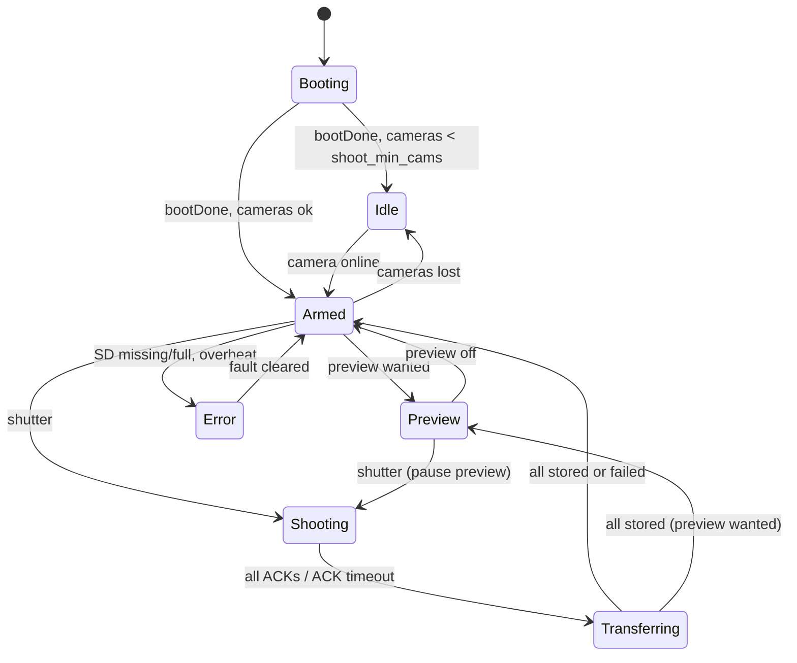

# Firmware

## Toolchain and pinned versions

| item | version | why |
|---|---|---|
| PlatformIO Core | 6.2.0 (CI pins it) | tested in this repo |
| Platform | **pioarduino** `55.03.312-1` (Arduino-ESP32 **3.3.12** on ESP-IDF **5.5.5**) | the camera needs the `MEGA_CCM` driver in esp32-camera, which only ships with Arduino-ESP32 3.x; M5's own guide for the new CamS3-5MP revision says "latest esp32 core". Stock `platformio/espressif32` is stuck on Arduino 2.x. Same platform on the Core so both share one toolchain ([DECISIONS ADR-003](DECISIONS.md)) |
| M5Unified | 0.2.29 (git tag) | CoreS3-SE support incl. the no-battery external-5V safety check |
| M5GFX | 0.2.36 (git tag) | required by M5Unified 0.2.29 (`>=0.2.35`) |
| LVGL | 9.6.0 (git tag) | latest 9.x; `RGB565_SWAPPED` image support used by the preview |
| ArduinoJson | 7.4.3 (git tag) | HTTP API |
| esp32-camera | bundled with Arduino-ESP32 3.3.12 libs (`CONFIG_MEGA_CCM_SUPPORT=1`) | not a separate dependency |
| platform-native | 1.2.1 (git tag) + Unity ^2.6.1 | host unit tests |

Libraries are referenced by **git tag URLs** (not the PlatformIO registry) so builds are
reproducible and work behind proxies that block the registry. Board for the Core:
`m5stack-cores3` (pioarduino, QIO flash, quad PSRAM, USB CDC on boot, 16 MB). Board for the
camera: local `camera/boards/m5stack-unitcams3.json` (QIO flash + **OPI PSRAM**, variant
`m5stack_unit_cams3`, USB CDC on boot), confirmed `qio_opi` in the build.

Build flags of note: `-std=gnu++17`, `-DLV_CONF_INCLUDE_SIMPLE`, `-DLV_LVGL_H_INCLUDE_SIMPLE`,
`-DX4_GIT_HASH=…` (from `tools/pio_git_rev.py`), `-DX4_CAM_ID=N` per camera env,
`-DX4_APP_HELLO=1` / `-DX4_APP_HELLO_UI=1` / `-DX4_CAM_HELLO=1` for the Stage 0 builds.

## Repository layout

```
x4/
├─ core/                    PlatformIO project, CoreS3-SE
│  ├─ platformio.ini        envs: core, core-hello, hello-ui, native
│  ├─ include/              lv_conf.h, board_pins.h, secrets.h.example, x4_secrets.h
│  ├─ src/main.cpp          setup()/loop() only
│  ├─ src/app/              app.cpp (boot + loop + state machine glue), config_store, status
│  ├─ src/display/          LVGL ↔ M5GFX flush + touch glue
│  ├─ src/input/            button / touch swipes / encoder stub → logical actions
│  ├─ src/net/              SoftAP, UDP, camera registry, transfer, preview, web server+page, OTA
│  ├─ src/storage/          microSD (shared SPI bus), shot files, SD log sink
│  ├─ src/hw/               power safety, flash driver, system info, SPI lock
│  ├─ src/log/              log sinks
│  ├─ src/ui/               hand-written LVGL UI, tokens.h (generated), fonts/ (generated)
│  ├─ src/ui_gen/           reserved for LVGL Pro/XML export (never hand-edited)
│  ├─ src/hello_ui/         the hello-ui smoke test
│  └─ test/test_shared/     native unit tests
├─ camera/                  PlatformIO project, Unit CamS3-5MP: envs cam1..cam4, cam-hello
├─ shared/                  library used by both (symlink://../shared): log, config schema,
│                           safety, protocol, input, shooting FSM, storage layout, dither
├─ ui/                      design source: tokens.json, fonts (TTF + OFL), assets
├─ app/                     companion app (stub)
├─ tools/                   generators and the log tool
├─ docs/
└─ .github/workflows/       CI
```

Rules: UI code never makes network calls (it calls `x4core::app::request()` and renders
`x4core::Status`); regenerating UI code only touches `ui_gen/`; both firmwares use `shared/`.
The brief's `-I../shared` became a PlatformIO `symlink://../shared` library so `.cpp` files
compile too ([DECISIONS ADR-005](DECISIONS.md)).

## Core firmware

### Tasks

| task | core | prio | job |
|---|---|---|---|
| `loopTask` (Arduino) | 1 | 1 | input poll, app state machine, LVGL `lv_timer_handler()`, thermal/SD/power checks, status publish. Never blocks on the network. Loop WDT on. |
| `udp_tx` | 0 | 7 | SHOOT fan-out (broadcast + unicast, `trig_repeat` copies) |
| `udp_rx` | 0 | 6 | heartbeats → immediate clock-sync answer, ACKs → app queue, camera logs → sinks |
| `xfer0..3` | 0 | 4 | pull photos over HTTP, write to SD in 16 KB chunks |
| `web` | 0 | 3 | WebServer: page + API + /register |
| `preview` | 0 | 2 | polls the preview camera for QVGA JPEGs |
| `esp_timer` | – | – | flash pulse end, scheduled flash fire |

Cross-task data: FreeRTOS queues (ACKs, transfer results, requests, input events, SD log lines),
a mutex-guarded camera registry, a mutex-guarded `Status` snapshot, and the SPI recursive mutex
(LCD + SD share the bus).

### State machine

Pure logic in `shared/src/shoot.cpp` (unit-tested), driven by `core/src/app/app.cpp`.



| state | shutter | UI |
|---|---|---|
| Booting | refused | splash, then "starting" |
| Idle | refused ("not ready") | "waiting for eyes · n of 4" over the dark viewfinder |
| Armed | **accepted** | "n of 4 eyes ready" (no preview frame yet) |
| Preview | **accepted** (preview pauses) | live photo full-bleed + footer (full mode) |
| Shooting | refused ("busy") | white-out, then the holographic "Saving..." overlay |
| Transferring | refused ("busy") — the next shot waits until buffers are free | "Saving..." with "k of n" |
| Error | refused ("error") | red "Error" overlay + reason ("no sd card", "sd card full", "too hot, cooling") |

Effects the app performs: send trigger, schedule flash, pause/resume preview, start transfers
(respecting `xfer_parallel`), write the sidecar, UI moments (`shutterMoment`, `shotCaptured`,
`shotStored`, `shutterRefused`). Screens and overlays: [UI.md](UI.md). Faults: no cameras, SD missing, SD full (< 12 MB), overheat.
Brown-out is reported (boot log, diagnostics, web) but is not a blocking state.

### Shot timeline

```
t=0      shutter press (button Press edge, no debounce delay) → state Shooting
t≈0      SHOOT shot=N at=T (T = now + trig_lead_ms) → broadcast + unicast ×3
t≈T      cameras capture at their local T (clock-synced), flash fires at T − flash_lead_ms
t≈T+…    each camera ACKs (cap timestamp in Core time) → "captured" moment when all ACKed
         transfers start as soon as the first ACK arrives (pull, ≤ xfer_parallel at once)
t≤5 s    all JPEGs + shot.json on SD → "saved · 3.4 s" toast; next shot allowed
```

### Memory map (Core)

| region | use |
|---|---|
| internal RAM (≈ 512 KB SRAM) | LVGL draw buffers 2 × 320×40×2 = 50 KB (DMA-capable), WiFi/lwIP, task stacks (~60 KB), log ring 128 × 200 B = 25 KB |
| PSRAM (8 MB, quad) | LVGL widget heap (CLIB malloc spills there), preview JPEG 64 KB ×2, preview RGB565 canvas 150 KB, transfer chunk buffers 4 × 16 KB, web file buffer |
| flash (16 MB) | `default_16MB.csv`: 2 × 6.25 MB app slots (OTA), NVS, SPIFFS (unused). Fonts ≈ 700 KB |

Build result (this commit): `core` 27.7 % flash / 26.6 % static RAM; cameras 18.7 % / 26.4 %.

### Input

```
physical source ──driver──▶ (Source, Gesture, value) ──InputMap──▶ Action ──▶ app / UI
```

Sources: `shutter` (Port A G1), `touch` (swipes; taps go straight to LVGL widgets), `button1..3`
(M-Bus G8/G9, build flag `X4_EXTRA_BUTTONS`), `encoder` (G5/G6 quadrature stub,
`X4_ENCODER_QUADRATURE`), `web`. Gestures: `press release click long double swipe_left
swipe_right swipe_up swipe_down rotate`. Actions: `shutter next prev select back scroll menu
diagnostics flash_toggle preview_toggle`.

Default bindings (`shared/src/input.cpp`):

| binding | action |
|---|---|
| `shutter.press` | shutter (fires on the first contact edge: no debounce latency) |
| `shutter.long` | diagnostics |
| `touch.swipe_left / swipe_right` | next / prev |
| `touch.swipe_down` | back |
| `touch.swipe_up` | menu (diagnostics) |
| `button1.click / button2.click / button3.click` | flash_toggle / preview_toggle / menu |
| `encoder.rotate / encoder.click / encoder.long` | scroll / select / back |
| `web.click` | shutter |

The map has a text form (`InputMap::parse`): `shutter.long=menu,encoder.rotate=scroll,button1.click=none`.
**Adding a scroll wheel:** wire it to G5/G6 + GND, build with `-DX4_ENCODER_QUADRATURE=1`; it
emits `encoder.rotate` with ± detents and the UI receives `scroll` actions. For an I2C encoder,
write a `Driver` subclass in `inputs.cpp` that polls it and emits the same gestures.

### Battery estimate

`shared/include/x4/energy.h` (unit-tested). Every 250 ms the app estimates the rig's draw from a
power model (`pw_core_mw` + per online camera `pw_cam_idle_mw` / `pw_cam_strm_mw` /
`pw_cam_busy_mw` by heartbeat state, + flash pulses at 5 W × pulse) and integrates it.
Remaining = `bat_cap_mwh × bat_eff_pct − used`. `used` is saved in NVS every 60 s and after each
stored shot (power can disappear any time; at most a minute is lost). It cannot detect that the
bank was recharged, so the user resets it: long-press the footer percentage → "Bank charged?",
or *Bank charged* on the web page (`bat_full`). Accuracy depends on calibrating `pw_*_mw` with the
USB meter (MEASUREMENTS.md).

## Camera firmware

Boot: banner → config → **stagger `id × cam_stagger_ms`** → hardware-revision probe (SCCB
0x1F/0x0200) → `esp_camera_init` (JPEG, 5 MP, 2 × 2.5 MB PSRAM buffers, GRAB_LATEST) → sensor PID
check (refuse capture if not MEGA_CCM) → [cam-hello: benchmark every size] → WiFi STA on the
Core's channel, `WiFi.setSleep(false)` → UDP + HTTP + OTA → register with the Core (retry with
backoff).

| task | core | prio | job |
|---|---|---|---|
| `shooter` | 1 | 10 | waits until the scheduled local time, grabs two frames, keeps the one whose start is closest to the target, holds it |
| `udp_rx` | 0 | 6 | SHOOT (dedupe by shot id), clock-sync answers, commands |
| `hb` | 0 | 3 | heartbeat every `hb_period_ms` (also clock-sync request), forwards WARN+ logs |
| httpd :80 / :81 | – | – | API / MJPEG |

Capture accuracy: the sensors free-run, so a frame starts somewhere within one frame period of
the target. Taking the closer of "latest before" and "first after" bounds the error to half a
frame period plus clock-sync error (≈ RTT/2, typically < 2 ms on a quiet AP; ASSUMPTION). The
real numbers (`vs_plan_us` in the camera log, `cap_offset_us` and `skew_us` on the Core) go into
MEASUREMENTS.md.

Camera identity: build env `camN` sets `X4_CAM_ID=N`; NVS `cam_id` (set with
`GET /settings?cam_id=N`) overrides it after a reboot. `cam-hello` has no id and joins your home
WiFi instead of the Core.

## Tests

`cd core && pio test -e native` — 31 host tests: log format/levels/rate limit/ring, config
validation + tighten-only + schema-vs-safety limits, flash guard, protocol round-trips + garbage,
clock sync, input map + debouncer + swipes, shooting FSM (happy path, timeouts, retries, faults,
stale ACKs), storage paths + sidecar, dithering. CI also checks that generated tokens/docs are
fresh and builds all 8 firmware environments.
