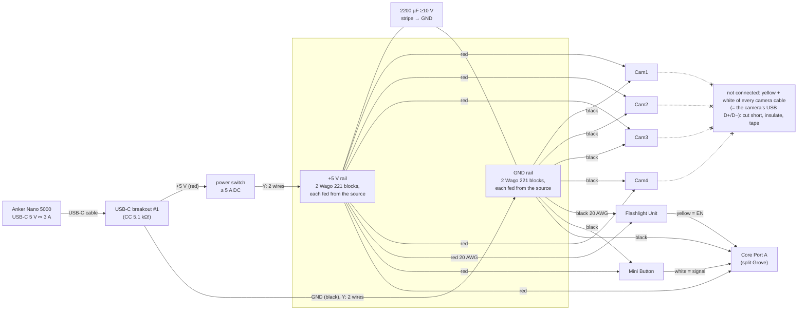
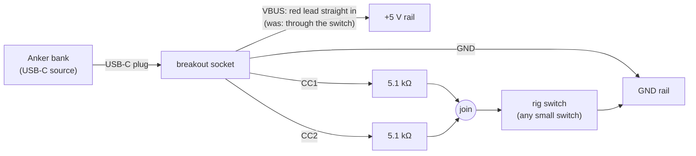

# Wiring

> ### ⚠ One 5 V source per board, always
> **Before you plug USB-C into the Core or a camera: switch the rail OFF and unplug that board's
> Grove power lead.** Reconnect the rail only after the USB cable is out. On the Core, USB 5 V and
> the rail meet inside the board (see [POWER.md §2c](POWER.md#2-feeding-the-core-through-port-a-brief-32)).
> On a camera the Grove port *is* the USB port, so it cannot be on both anyway.
> Full procedure: [BRINGUP.md](BRINGUP.md#flashing-without-breaking-the-power-rules).

## Diagram



ASCII version (same thing):

```
                                       ┌─ +5V block 1: feed  cap(+)  flash  core  cam1
Bank─USB-C─[breakout]─red─[SWITCH]─Y───┤
                  │                    └─ +5V block 2: feed  cam2  cam3  cam4  button
                  └─black──────────Y───┬─ GND block 1: feed  cap(−)  flash  core  cam1
                                       └─ GND block 2: feed  cam2  cam3  cam4  button
Two 5-port blocks per net, each fed straight from the source (the Y), no jumper between them:
10 ports, 10 connections (WIRING.md#connectors). With the CC switch mod there's no switch in
the red line, and both Ys sit at the breakout's pads.
For current the multimeter goes across the open switch: red probe on the switch's input
terminal, black probe on its output terminal, both with clip leads (STEPS.md#measuring-current).

Core Port A (one Grove plug, wires split):
   red   ── +5V rail          (Core power IN)
   black ── GND rail
   yellow (G2) ── Flashlight yellow (EN)
   white  (G1) ── Mini Button white (signal)

Each camera Grove cable:  red → +5V rail, black → GND rail, yellow + white → cut short, insulate, tape.
Flashlight: red/black on their own 20 AWG branch to the rail (1 A pulses), white NC.
Mini Button: red → +5V rail, black → GND rail, white → Core Port A white. (yellow NC)
```

## Pin table

| from | wire | to | net | notes |
|---|---|---|---|---|
| bank USB-C | cable | breakout #1 USB-C | – | breakout needs 5.1 kΩ CC pull-downs (or use bank USB-A + A-to-C cable) |
| breakout V/VBUS | red 20 AWG | switch → +5V rail | +5 V | switch in +5 V only. The switch's input side is **live whenever the bank is on**, switch on or off |
| breakout G/GND | black 20 AWG | GND rail | GND | |
| Cam1..4 Grove red | red | +5V rail | +5 V | one branch each (star) |
| Cam1..4 Grove black | black | GND rail | GND | |
| Cam1..4 Grove yellow | yellow | **nothing** | USB D+ (G20) | cut and tape |
| Cam1..4 Grove white | white | **nothing** | USB D− (G19) | cut and tape |
| Core Port A red | red | +5V rail | +5 V (`BUS_OUT`) | Core power **input** |
| Core Port A black | black | GND rail | GND | |
| Core Port A yellow (G2) | yellow | Flashlight Grove yellow | flash EN | 3.3 V logic; unit has 10 k pull-down |
| Core Port A white (G1) | white | Mini Button Grove white | button signal | active LOW, internal pull-up on |
| Flashlight red | red → 20 AWG | +5V rail | +5 V | own branch, ≤ 30 cm |
| Flashlight black | black → 20 AWG | GND rail | GND | |
| Flashlight white | white | nothing | NC | |
| Mini Button red | red | +5V rail | +5 V | see HARDWARE.md: released level 3.3 V |
| Mini Button black | black | GND rail | GND | |
| Mini Button yellow | yellow | nothing | NC | |
| 2200 µF + | leg | +5V rail | +5 V | **parallel**, stripe side to GND |
| 2200 µF − (stripe) | leg | GND rail | GND | |

Colour convention: **red = +5 V, black = GND, yellow = signal/data (EN on the flash, D+ on
cameras), white = second signal (button, D− on cameras)**. Mark the cut camera data wires with
tape so nobody "fixes" them later.

## Connectors

The rail uses **Wago 221 lever connectors** (owner, 2026-11-13; it was 2273 push-in before).
- ASSUMPTION (Wago's spec as remembered, check the print on yours): the 221-41x series takes
  **solid, stranded and fine-stranded** wire, 0.2–4 mm², strip length 11 mm, in 2-, 3- and 5-port
  sizes. So the 20 AWG stranded wire (0.52 mm²) goes straight in: no pigtails, no ferrules.
- **Grove wires are thin.** Their gauge is Not sure (often quoted as 26–28 AWG, 0.08–0.13 mm²),
  which would be under the 221's 0.2 mm² minimum. Strip ~22 mm and fold the bare end double,
  or keep a solid/20 AWG pigtail soldered on. Then tug-test.
- **Tug-test every connection** with the lever closed. Connection quality, not gauge, is the
  limit. Do not tin stranded wire for clamp terminals (solder creeps, the contact loosens).
- How to solder the breakout leads, splices and pigtails, and how to check them:
  [SOLDERING.md](SOLDERING.md).
- **Ports: two 5-port blocks per net, each fed straight from the source, no jumper**
  (owner, 2026-11-15). Each net has 9 loads and sources (source, 4 cams, Core, flash, button,
  cap). A jumper between two blocks would take 2 of their 10 ports and leave 8, one short. Feeding
  each block with its own wire from the source (a **Y**) uses 1 port per block instead: 10 of 10.
  - **Block 1:** feed, capacitor, flashlight, Core, cam 1. **Block 2:** feed, cam 2, cam 3,
    cam 4, button. Same split on GND. The flash and the capacitor share a block, so the flash's
    1 A pulses draw on the capacitor without going through the other block's feed.
  - **Where the Y goes.** With the CC switch mod (the switch on the CC resistors, red lead
    straight to the rail): two 20 AWG red leads soldered to the breakout's **VBUS pad**, two
    black to its **GND pad**. Or one lead per pad, Y-spliced into two
    ([SOLDERING: splice](SOLDERING.md)). Without the mod (switch in the 5 V line): two red wires
    from the switch's **output** lug, two black from the breakout's GND pad.
  - Each feed carries only its block's share of the current: 20 AWG, short, tug-tested.
  - **No free port is left for probes.** When a measurement needs one, pull the Mini Button's
    lead out of that block (power checks don't need the button) and put it back afterwards.
  - **Fallback if you can't solder a Y:** splice the Mini Button's red into the Core Port A red,
    and black into black. One lead then goes into one port per net. The button draws next to
    nothing and both leads run to the Core anyway. Don't double up the flash (1 A pulses), the
    capacitor (should sit on the rail itself) or two cameras (one bad joint would take both).

## Switching the rig on and off

**The problem (owner, 2026-11-14):** flipping the rail switch on doesn't start the bank once it
has gone to sleep; its button has to be pressed too. The button can't turn the bank **off**
either.

**Why** (the owner's re-plug test below confirms it for the A1653):
- A USB-C power bank switches its output on when it sees a device plug in, and off when it
  unplugs. It sees that through the CC resistors (5.1 kΩ to GND). **VERIFIED:** USB-C sources
  apply VBUS only after detecting an attached sink and remove it after a detach. Source: the
  USB-C spec timing, as mirrored by the Zephyr USB-C constants, see
  [SOLDERING](SOLDERING.md#sources).
- The breakout's CC resistors sit on the bank's side of the switch. So the bank sees "plugged
  in" all the time, switch on or off.
- With the switch off nothing draws current, and the bank's low-current auto-off stops the
  output. Anker's general articles say about 30–90 mA keeps a bank on (*Not sure* for the A1653).
- Switching on later changes nothing the bank can see: no new plug-in. So it stays off until its
  button is pressed.

**The re-plug test** (proves a CC switch will work, no parts needed): leave the bank in the
breakout with nothing drawing until it sleeps (0 V at the VBUS pad or the switch input), then unplug and
re-plug it **without** pressing the button. A physical re-plug is the same "plug-in" signal a CC
switch makes. **Result (owner, 2026-11-14): 5 V comes back by itself**, so a fresh plug-in wakes
the A1653 and the CC switch (option B) will work.

Three ways to deal with it:

| option | actions to switch on / off | standby drain | build |
|---|---|---|---|
| **C. Bank button** (today) | rail switch on + bank button / rail switch off | ≈ 0 | nothing |
| **A. Keep-alive resistor** | rail switch / rail switch | **≈ 0.5 W, all the time** | one resistor |
| **B. CC switch** | one switch / the same switch | ≈ 0 | small breakout mod |

### A. Keep-alive resistor (evaluated: not recommended)

A resistor that is always connected **before** the switch keeps a load on the bank, so it never
hits its low-current auto-off. The switch then only connects the rig.

```
Bank─USB-C─[breakout]─red──┬──────────[SWITCH]─── +5V rail
                              │
                           47 Ω ≥ 2 W   (the keep-alive load, always on)
                              │
                  └─black─────┴──────────────────── GND rail
```

Wiring: one 47 Ω resistor rated **≥ 2 W** (1 W minimum) from the switch's input terminal (or the
breakout's VBUS pad) to the GND rail. Keep it off the foam board and plastic with an air gap: it
runs warm.

**Power draw** (5 V rail; bank energy as in [POWER §3](POWER.md#3-power-numbers-all-estimates-until-measured):
14.8 Wh usable, ASSUMPTION):

| | value |
|---|---|
| current | 5 V / 47 Ω ≈ **106 mA**: above Anker's 30–90 mA (*Not sure* it's enough for the A1653) |
| power, all the time | 5² / 47 ≈ **0.53 W** |
| a full bank, rig switched off | flat in about **28 h** (14.8 Wh / 0.53 W) |
| runtime while shooting, ~3.5 W rig | 4.2 h → **≈ 3.7 h** (−12 %) |
| runtime at ~7 W | 2.1 h → **≈ 2.0 h** (−7 %) |
| heat | 0.53 W in one resistor, continuously |

A smaller load (e.g. 100 Ω ≈ 50 mA, 0.25 W, ~59 h) wastes less, but may sit under the bank's
threshold (*Not sure*). Some keep-alive designs pulse the load instead (e.g. 100 mA for a split
second every few seconds) to waste far less. But nobody knows the A1653's timing, and that's a
timer circuit, more work than option B.

**Verdict:** it works only while the bank is plugged in. It quietly empties a full bank in about
a day, so you'd unplug the bank after every session anyway, which is no better than today.

### B. CC switch (recommended: one switch does everything)

Proven to work on the A1653 by the re-plug test above. Move the switch from the 5 V line to the CC resistors. **Switch off** takes the "device present"
resistors away, so the bank sees an unplug and turns its output off by itself. **Switch on** puts
them back, so the bank sees a fresh plug-in and turns on, every time, with no button.



The breakout, before and after (schematic; where the parts sit on your board is *Not sure*):

```
BEFORE (stock breakout)                    AFTER (CC switch mod)

 CC1 ──[5.1k]── GND                         CC1 ──[5.1k]──┐
 CC2 ──[5.1k]── GND                         CC2 ──[5.1k]──┤
                                                          └──o/ o── GND
 VBUS ── red ──[SWITCH]──────── +5V rail                 rig switch
 GND  ── black ───────────────── GND rail   VBUS ── red ─────────────────── +5V rail
                                            GND  ── black ─────────────── GND rail
                                            (on-board 5.1k resistors removed or cut free)
```

**Parts:** the rig switch you have (now it carries only a fraction of a milliamp, ASSUMPTION; any
small switch works), thin wire, heat-shrink. Resistors: either **reuse the breakout's own two
5.1 kΩ** (free GND end of each, wire both freed ends to the switch: nothing to buy), or two new
5.1 kΩ (any size and wattage) if lifting the on-board ones is too fiddly on your board.

**Steps** (practice on a **spare** breakout first; bank unplugged):
1. **Find the on-board CC resistors.** Ohms, breakout unplugged: CC1 pad → GND and CC2 pad → GND
   each read ≈ 5.1 kΩ. Look for two small resistors marked **512** (5.1 kΩ in the 3-digit code)
   near the socket. Which end goes to CC and which to GND: *Not sure* for your board, so trace it
   with the meter's beep.
2. **Disconnect them from GND.** Either lift one end of each resistor with the iron, or cut the
   track between the resistor and GND with a sharp knife. Afterwards CC1 → GND and CC2 → GND must
   read **OL**.
3. **Reusing the on-board resistors?** Solder a thin wire to each freed GND-side end and join the
   two wires: that join is your switch point; skip to step 4. **Otherwise add new resistors:**
   one 5.1 kΩ from CC1, one from CC2. Solder to the CC pads, or to the
   CC end of the old resistors if the board has no CC pads. Join their free ends in one
   heat-shrunk joint.
4. **Wire the switch:** from that join to the switch, and from the switch to GND (a GND pad or
   the GND rail). Tie the thin wires down next to the breakout (strain relief,
   [SOLDERING R2](SOLDERING.md#r2-wire-to-a-breakout-pad-vbus-gnd)).
5. **Take the old switch out of the 5 V line:** the breakout's red lead goes straight into the
   +5 V rail.

**Check** (bank unplugged, ohms):

| switch | CC1 → GND | CC2 → GND |
|---|---|---|
| off | OL | OL |
| on | ≈ 5.1 kΩ | ≈ 5.1 kΩ |

Then with the bank in and no boards on the rail: switch **off** → rail ≈ 0 V; switch **on** →
4.75–5.25 V within a moment. A USB-C source waits at least ~100 ms after a plug-in before it
switches power on, and has to drop power within 650 ms of an unplug (spec timing via Zephyr's
constants; the A1653's own timing is *Not sure*). Do it 10 times. Then leave it switched off for
longer than the bank's sleep time and switch on again: it must come on with no button.

**Things that change with the mod:**
- **Current measurement:** the meter used to go across the switch. Now each block has its own
  feed, so measure them one at a time: switch off (bank output off), pull block 1's red feed out
  of its Wago, red probe clipped to its bare end, black probe in the freed port, switch on, read,
  switch off, feed back. Then the same for block 2. The rig's current is the sum: the blocks
  share nothing else on +5 V ([STEPS: measuring current](STEPS.md#measuring-current)).
- **Turn-on:** the bank needs a moment (≥ ~100 ms) after the switch before the rail is live.
  Harmless.
- **Not sure:** whether the A1653 likes being "plugged in" and "unplugged" many times a day this
  way. It's the same as plugging it in, which it's built for.
- Two separate 5.1 kΩ resistors (not one shared one) keep each CC pin looking like a standard
  device. With a 2-pole switch you could switch each resistor on its own pole; one pole after
  the join works too (ASSUMPTION).

**Before building:** your breakout's markings decide where steps 1–3 happen. Write them in
[HARDWARE: recorded on bring-up](HARDWARE.md#recorded-on-bring-up-fill-in).

## Spare ports and future inputs

| resource | where | state | intended use |
|---|---|---|---|
| G1 | Port A white | **used** | shutter button |
| G2 | Port A yellow | **used** | flash EN |
| G7 | M-Bus pin 22 | free | **fallback flash EN** (`kFlashEnAlt`) if G2 idles high |
| G8 | M-Bus pin 4 | free | feature button 1 (`-DX4_EXTRA_BUTTONS=1`) |
| G9 | M-Bus pin 10 | free | feature button 2 |
| G5, G6 | M-Bus pins 8, 21 | free | **quadrature scroll wheel** (`-DX4_ENCODER_QUADRATURE=1`, driver stub in `core/src/input/inputs.cpp`) |
| G17, G18 | M-Bus pins 16, 15 | free | UART or two more buttons |
| G10 | M-Bus pin 2 | free | ADC (e.g. rail voltage divider later) |
| 5 V / GND | M-Bus 28 / 1,3,5 | rail node | do not draw extra loads through the Core |
| 3V3 | M-Bus 12 | Core's 3.3 V | low-current pull-ups only |

Dupont jumpers fit the M-Bus header (2×15, 2.54 mm, VERIFIED M5 Bus Socket spec). Buttons on
M-Bus: one leg to the GPIO, other leg to a GND pin; the firmware uses the internal pull-up.

**I2C encoder/scroll units** (e.g. an M5 encoder unit on Grove) need SDA/SCL. On the SE the only
Grove I2C pins are Port A G2/G1, which x4 uses for the flash and the button. To add an I2C unit:
move the flash EN to G7 and the button to G8 (M-Bus), free Port A G1/G2 for I2C, and power the
unit from the rail (its own branch). The firmware has the pins in `board_pins.h`; the input layer
maps the new source to actions with no UI change ([FIRMWARE.md](FIRMWARE.md#input)).

## Future low-latency trigger (documented, not built)

A hardwired trigger line from a Core GPIO to every camera would cut skew to microseconds. On the
CamS3 the only external pins are the Grove yellow/white = **G20/G19 = USB D+/D−**. Using them as
a trigger means losing USB serial/flashing on that pin pair while the line is attached, and a
wrong level during boot could put the USB PHY in a bad state. If ever built: series 1 kΩ per
camera, use the white (G19) line, and unplug it before flashing.

## Printable pre-power checklist

```
x4 PRE-POWER CHECKLIST                           date ______  by ______
[ ] Switch OFF. Bank unplugged.
[ ] Rail V ≈ 0 first. Beep/ohms +5V rail ↔ GND rail: silent or a chirp (OL or climbing), never a steady beep / < ~5 Ω.
[ ] Beep/ohms each red wire ↔ +5V rail and each black ↔ GND rail: solid beep (≈ 0 Ω), also while flexed.
[ ] Capacitor stripe (−) on GND rail. Rated ≥ 10 V.  Value ____ µF  ____ V
[ ] Camera yellow + white wires cut, insulated, taped (×4).
[ ] Core Port A: red→+5V, black→GND, yellow→flash yellow, white→button white.
[ ] Flash on its own 20 AWG branch. Flash slide switch on FLASH.
[ ] No USB-C cable in any board.
[ ] Every Wago lever closed, every wire tug-tested (Grove ends folded double or pigtailed).
[ ] +5V rail: one port free (meter).
[ ] Bank plugged in, switch ON with NO boards plugged: rail = 4.75–5.25 V  (measured ____ V)
[ ] Then follow BRINGUP.md step 4 (one load at a time).
```
