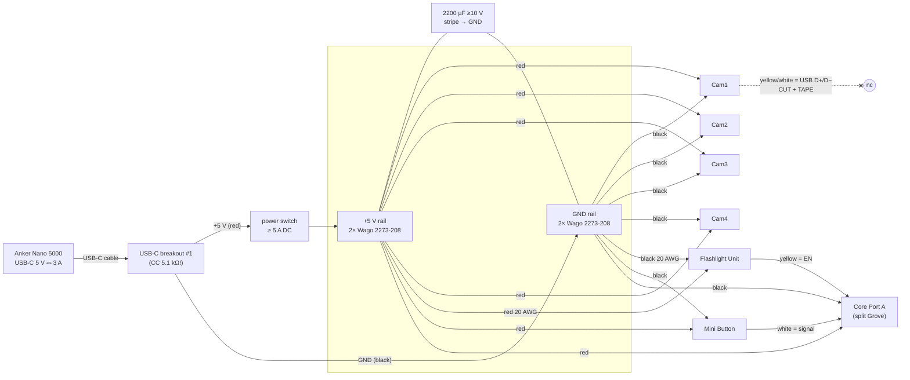

# Wiring

> ### ⚠ One 5 V source per board, always
> **Before you plug USB-C into the Core or a camera: switch the rail OFF and unplug that board's
> Grove power lead.** Reconnect the rail only after the USB cable is out. On the Core, USB 5 V and
> the rail meet inside the board (see [POWER.md §2c](POWER.md#2-feeding-the-core-through-port-a-brief-32)).
> On a camera the Grove port *is* the USB port, so it cannot be on both anyway.
> Full procedure: [BRINGUP.md](BRINGUP.md#flashing-without-breaking-the-power-rules).

## Diagram



ASCII version (same thing):

```
                 ┌─────────── +5V rail (2×2273-208) ──────────────┐
Bank─USB-C─[breakout]─red─[SWITCH]─┤ cam1 cam2 cam3 cam4  core  flash  button  cap(+)  spare… │
                  └─black──────────┤ cam1 cam2 cam3 cam4  core  flash  button  cap(−)  spare… │
                                   └─────────── GND rail (2×2273-208) ──────────────┘

Core Port A (one Grove plug, wires split):
   red   ── +5V rail          (Core power IN)
   black ── GND rail
   yellow (G2) ── Flashlight yellow (EN)
   white  (G1) ── Mini Button white (signal)

Each camera Grove cable:  red → +5V rail, black → GND rail, yellow + white → cut short, insulate, tape.
Flashlight: red/black on their own 20 AWG branch to the rail (1 A pulses), white NC.
Mini Button: red → +5V rail, black → GND rail, white → Core Port A white. (yellow NC)
```

## Pin table

| from | wire | to | net | notes |
|---|---|---|---|---|
| bank USB-C | cable | breakout #1 USB-C | – | breakout needs 5.1 kΩ CC pull-downs (or use bank USB-A + A-to-C cable) |
| breakout V/VBUS | red 20 AWG | switch → +5V rail | +5 V | switch in +5 V only |
| breakout G/GND | black 20 AWG | GND rail | GND | |
| Cam1..4 Grove red | red | +5V rail | +5 V | one branch each (star) |
| Cam1..4 Grove black | black | GND rail | GND | |
| Cam1..4 Grove yellow | yellow | **nothing** | USB D+ (G20) | cut and tape |
| Cam1..4 Grove white | white | **nothing** | USB D− (G19) | cut and tape |
| Core Port A red | red | +5V rail | +5 V (`BUS_OUT`) | Core power **input** |
| Core Port A black | black | GND rail | GND | |
| Core Port A yellow (G2) | yellow | Flashlight Grove yellow | flash EN | 3.3 V logic; unit has 10 k pull-down |
| Core Port A white (G1) | white | Mini Button Grove white | button signal | active LOW, internal pull-up on |
| Flashlight red | red → 20 AWG | +5V rail | +5 V | own branch, ≤ 30 cm |
| Flashlight black | black → 20 AWG | GND rail | GND | |
| Flashlight white | white | nothing | NC | |
| Mini Button red | red | +5V rail | +5 V | see HARDWARE.md: released level 3.3 V |
| Mini Button black | black | GND rail | GND | |
| Mini Button yellow | yellow | nothing | NC | |
| 2200 µF + | leg | +5V rail | +5 V | **parallel**, stripe side to GND |
| 2200 µF − (stripe) | leg | GND rail | GND | |

Colour convention: **red = +5 V, black = GND, yellow = signal/data (EN on the flash, D+ on
cameras), white = second signal (button, D− on cameras)**. Mark the cut camera data wires with
tape so nobody "fixes" them later.

## Connectors

- **Wago 2273-208 is specified for solid conductors** (0.5–2.5 mm²) by Wago (VERIFIED: Wago 2273
  data sheet). Your 20 AWG stranded wire and the thin Grove wires (≈ 26–28 AWG) are outside that
  spec and may not grip. In order of preference:
  1. solder each stranded/Grove wire to a short **solid-core** 20–22 AWG pigtail, heat-shrink
     the joint, push the solid end into the Wago;
  2. crimp a 0.5 mm² **ferrule** (fold thin wire back on itself first) — *Not sure* Wago endorses
     ferrules in the 2273; test each one;
  3. use Wago **221** lever connectors for stranded wire.
  Whatever you choose: **tug-test every connection.** Connection quality, not gauge, is the limit.
- Do not tin stranded wire for push-in terminals (solder creeps and the contact loosens).
- Two blocks per net, jumpered with a short solid wire: 9 connections per net today (source,
  4 cams, Core, flash, button, cap) leave 5 spare ports per net.

## Spare ports and future inputs

| resource | where | state | intended use |
|---|---|---|---|
| G1 | Port A white | **used** | shutter button |
| G2 | Port A yellow | **used** | flash EN |
| G7 | M-Bus pin 22 | free | **fallback flash EN** (`kFlashEnAlt`) if G2 idles high |
| G8 | M-Bus pin 4 | free | feature button 1 (`-DX4_EXTRA_BUTTONS=1`) |
| G9 | M-Bus pin 10 | free | feature button 2 |
| G5, G6 | M-Bus pins 8, 21 | free | **quadrature scroll wheel** (`-DX4_ENCODER_QUADRATURE=1`, driver stub in `core/src/input/inputs.cpp`) |
| G17, G18 | M-Bus pins 16, 15 | free | UART or two more buttons |
| G10 | M-Bus pin 2 | free | ADC (e.g. rail voltage divider later) |
| 5 V / GND | M-Bus 28 / 1,3,5 | rail node | do not draw extra loads through the Core |
| 3V3 | M-Bus 12 | Core's 3.3 V | low-current pull-ups only |

Dupont jumpers fit the M-Bus header (2×15, 2.54 mm, VERIFIED M5 Bus Socket spec). Buttons on
M-Bus: one leg to the GPIO, other leg to a GND pin; the firmware uses the internal pull-up.

**I2C encoder/scroll units** (e.g. an M5 encoder unit on Grove) need SDA/SCL. On the SE the only
Grove I2C pins are Port A G2/G1, which x4 uses for the flash and the button. To add an I2C unit:
move the flash EN to G7 and the button to G8 (M-Bus), free Port A G1/G2 for I2C, and power the
unit from the rail (its own branch). The firmware has the pins in `board_pins.h`; the input layer
maps the new source to actions with no UI change ([FIRMWARE.md](FIRMWARE.md#input)).

## Future low-latency trigger (documented, not built)

A hardwired trigger line from a Core GPIO to every camera would cut skew to microseconds. On the
CamS3 the only external pins are the Grove yellow/white = **G20/G19 = USB D+/D−**. Using them as
a trigger means losing USB serial/flashing on that pin pair while the line is attached, and a
wrong level during boot could put the USB PHY in a bad state. If ever built: series 1 kΩ per
camera, use the white (G19) line, and unplug it before flashing.

## Printable pre-power checklist

```
x4 PRE-POWER CHECKLIST                           date ______  by ______
[ ] Switch OFF. Bank unplugged.
[ ] Continuity +5V rail ↔ GND rail: must NOT beep.
[ ] Continuity each red wire ↔ +5V rail: beeps. Each black ↔ GND rail: beeps.
[ ] Capacitor stripe (−) on GND rail. Rated ≥ 10 V.  Value ____ µF  ____ V
[ ] Camera yellow + white wires cut, insulated, taped (×4).
[ ] Core Port A: red→+5V, black→GND, yellow→flash yellow, white→button white.
[ ] Flash on its own 20 AWG branch. Flash slide switch on FLASH.
[ ] No USB-C cable in any board.
[ ] Every Wago wire tug-tested.
[ ] Bank plugged in, switch ON with NO boards plugged: rail = 4.75–5.25 V  (measured ____ V)
[ ] Then follow BRINGUP.md step 4 (one load at a time).
```
